# LinkNest Architecture

High-level system design for LinkNest: React UI, PHP API, SQLite storage, background workers, and the in-app update pipeline. Diagrams below render as Mermaid in **Help → Guides → Architecture**.

## System overview

Browser clients talk to a same-origin PHP API. Session cookies authenticate users. SQLite in `data/` is the primary store; optional workers handle monitoring and email.

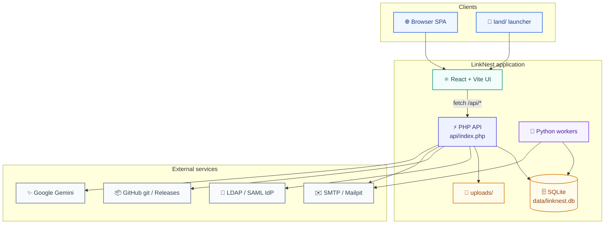

## Request path

Typical authenticated request from UI through the central router into an endpoint module.

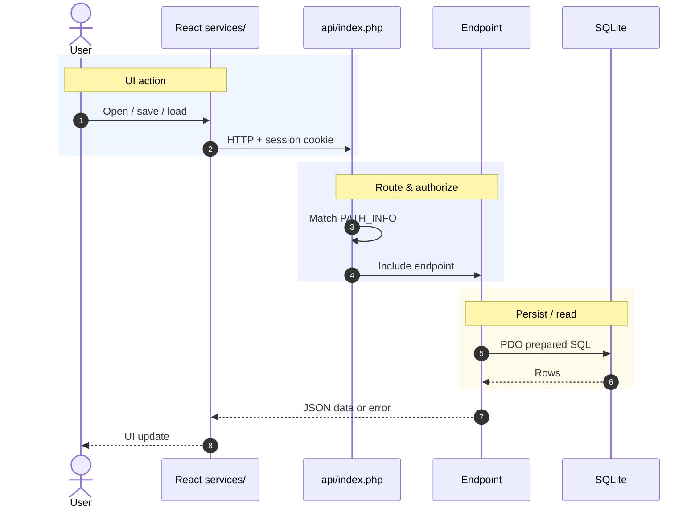

## Login sequence

How Local / LDAP / SAML settle into a PHP session used by the rest of the app.

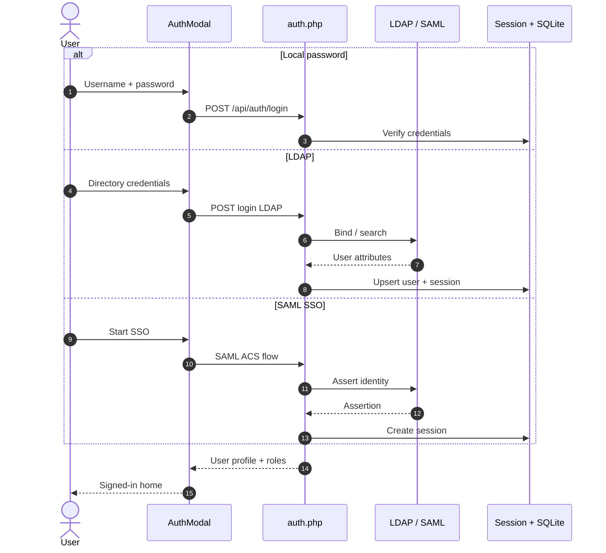

## Frontend structure

Contexts hold global auth/settings/styles. Feature UI lives in components; API access is centralized in services.

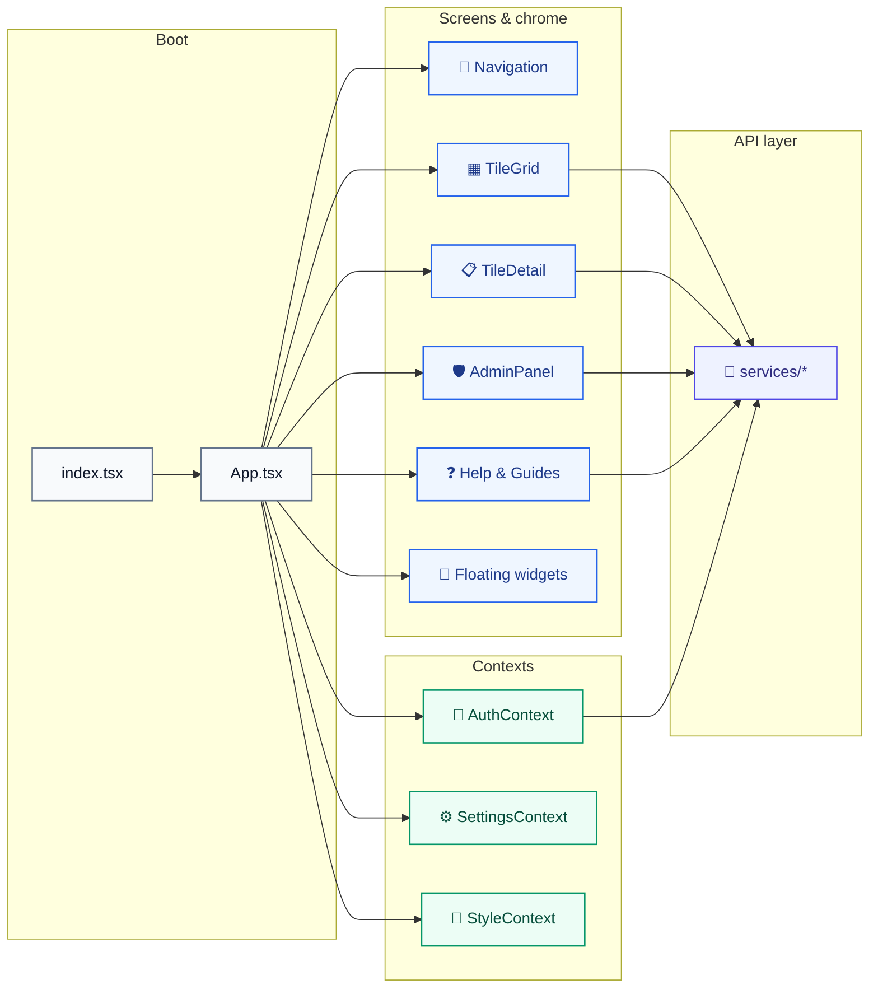

### Key frontend folders

| Path | Role |
|------|------|
| `components/` | Screens, dialogs, tiles, widgets |
| `contexts/` | Auth, settings, styles |
| `services/` | API clients (`storageService`, `authService`, `updaterService`, …) |
| `hooks/` | Shared hooks (e.g. mobile) |
| `utils/` | Markdown renderers, helpers |

## Save a tile (sequence)

What happens when an editor saves space content.

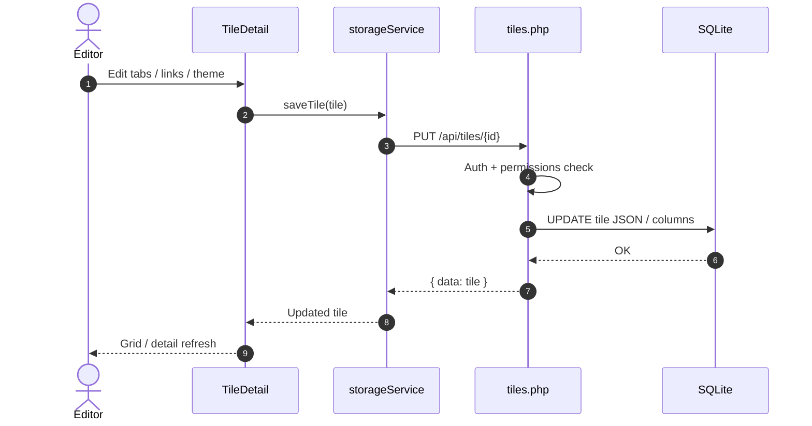

## Backend / API

`api/index.php` dispatches by path to focused PHP modules. Config and migrations live in `api/config.php`.

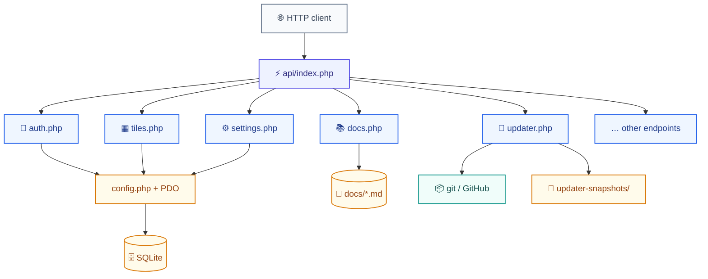

## Auth & access

Supported login methods feed a session-backed user. Tile visibility and RBAC/groups gate data.

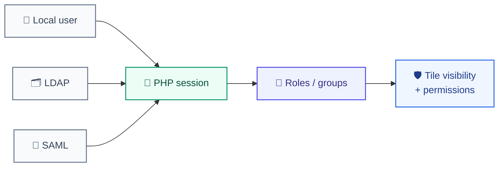

## Data model (conceptual)

Tiles are the primary entity: themes, tabs, sections, and links, plus visibility and allow-lists.

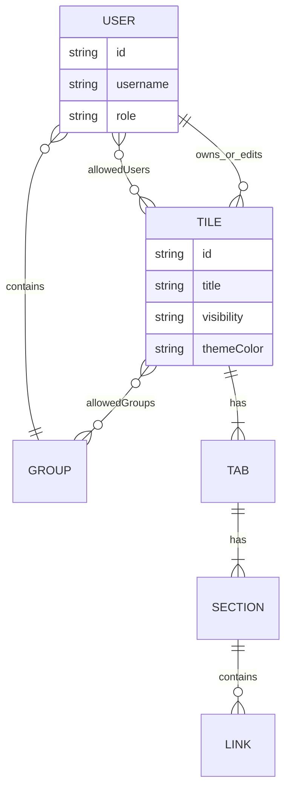

## App Updates pipeline

Admin → App Updates can preview commits/releases, optionally snapshot the DB, then apply via git (preferred on XAMPP) or ZIP packages.

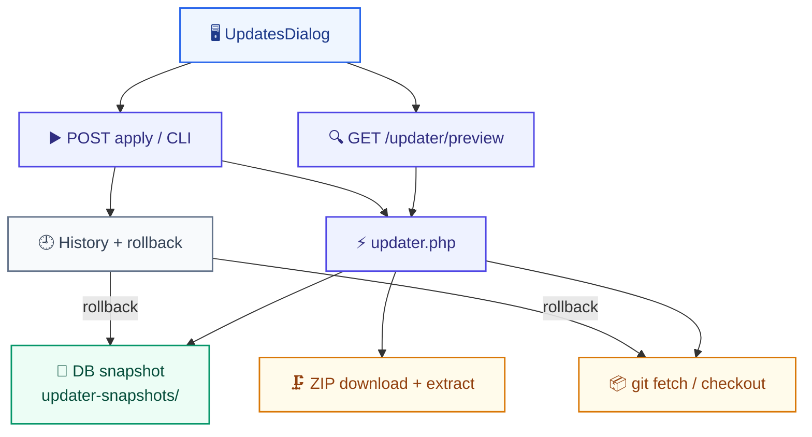

## Apply an update (sequence)

End-to-end flow when an admin confirms a commit or release.

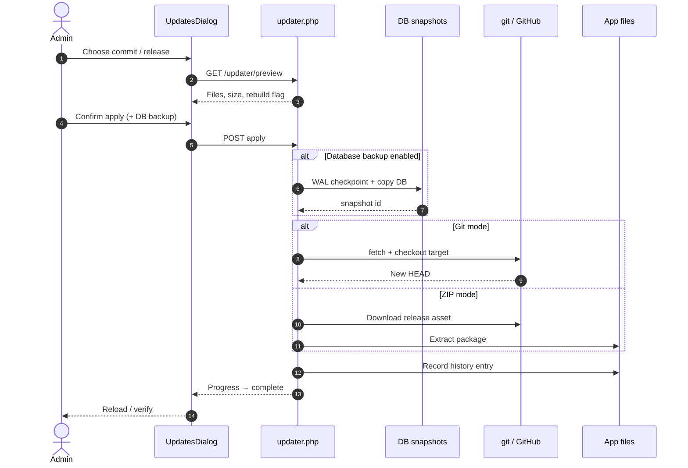

## Operations workers

Optional Python workers for monitoring and outbound email, sharing the same SQLite database and SMTP settings.

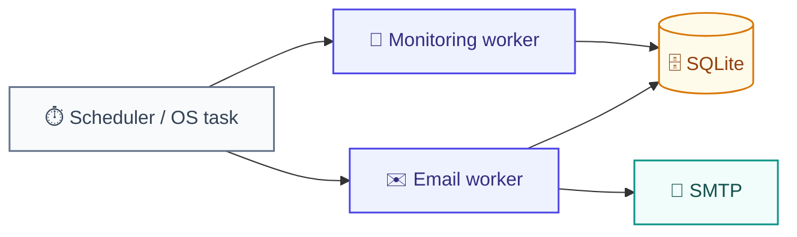

## Monitoring check (sequence)

How a scheduled worker records link health for the monitoring UI.

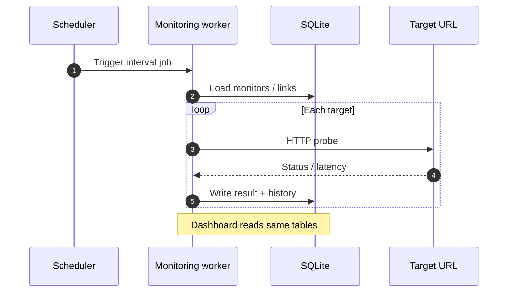

## Deploy shapes

| Mode | Notes |
|------|--------|
| XAMPP / Apache | Common local/prod path; PHP serves API + built `dist/` |
| Vite dev | `npm run dev` + `php -S` with API proxy |
| Docker | Multi-stage image: Apache + PHP + SQLite |

---

For setup and day-to-day ops, see **Getting Started** and **Updates & Deploy** in this same Guides panel.
