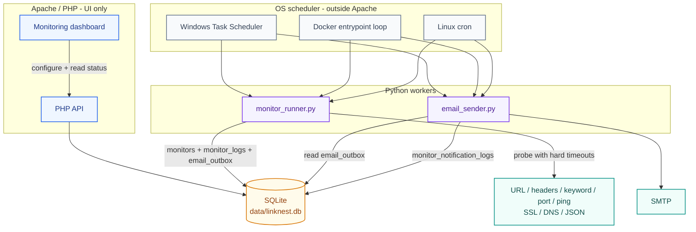
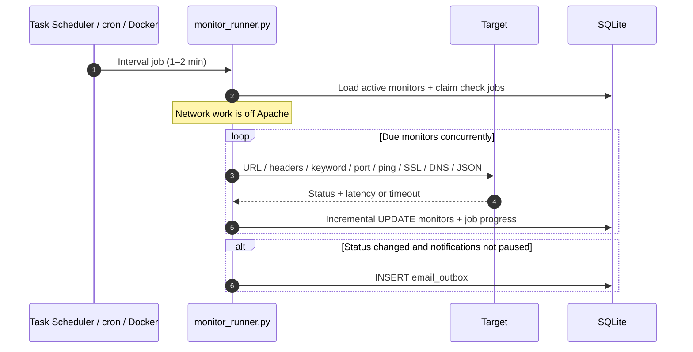
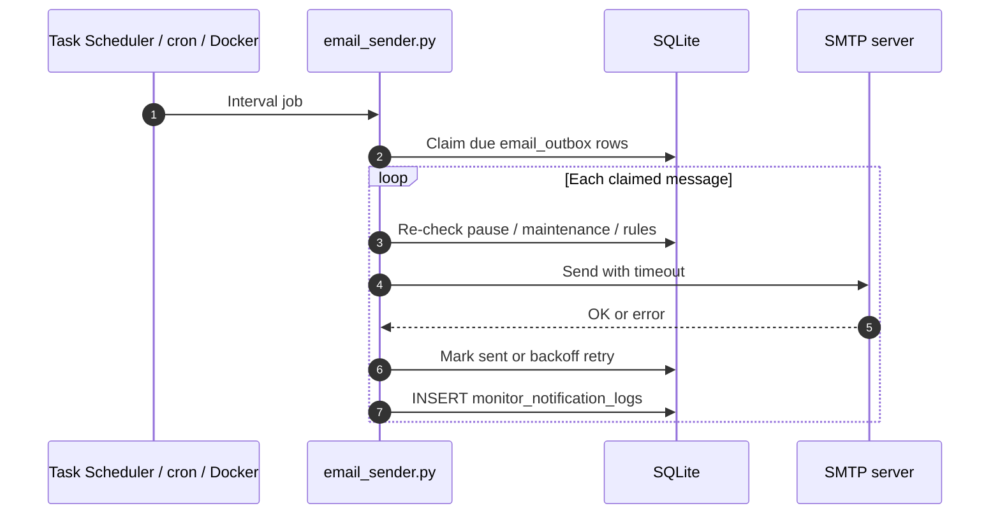

# Python Workers (Monitoring + Email) for LinkNest

These scripts offload scheduled monitoring and SMTP sending from PHP to Python, preventing **Apache/PHP from freezing** when endpoints or SMTP are slow.

Also in-app:

- **Help & About → Help → Python Monitor Workers & Task Scheduler** (CLI options, Task Scheduler install, examples)
- **Help & About → Help → System Monitoring Dashboard** (dashboard features)
- **Help & About → About → Python Monitor Workers & Task Scheduler** (summary)
- **Guides → Python Workers (Monitoring + Email)** (this document, searchable)

Workers run as **separate OS processes** (Windows Task Scheduler, Linux cron, or the Docker entrypoint). They are not Apache/PHP request handlers.

---

## Architecture

Apache/PHP serves the dashboard and stores monitor definitions. Checks and outbound mail run in Python and only share SQLite with PHP.



### Monitor runner sequence



### Email sender sequence



---

## Files

| File | Role |
|------|------|
| `scripts/monitor_runner.py` | Parallel probes, SQLite writes, email queue, force-all job processor |
| `scripts/email_sender.py` | SMTP send from `email_outbox` |
| `scripts/linknest_worker_lib.py` | Shared probe logic, schema helpers |
| `scripts/schedule-monitor-workers.ps1` | Install / verify / uninstall Task Scheduler jobs |
| `scripts/schedule-monitor-workers.bat` | Wrapper for the PowerShell installer |
| `api/monitor_check_jobs_lib.php` | Queue force-all jobs, kick runner from PHP |

---

## Requirements

- Python **3.9+**
- Stdlib only (no `pip install`)
- Same SQLite DB as PHP: `data/linknest.db`

---

## monitor_runner.py — CLI options

| Option | Default | Description |
|--------|---------|-------------|
| `--db` | `data/linknest.db` | SQLite path |
| `--max-workers` | setting or **20** | Parallel probe threads (**1–64**) |
| `--force-all` | off | Check every active monitor (ignore interval) |
| `--limit` | `0` (unlimited) | Max monitors to check this run |
| `--verify-ssl` | off | Verify TLS certificates |
| `--dry-run` | off | Probe only — no DB writes |
| `--verbose` | off | Log to stdout |

### Examples

```powershell
# Due monitors only (typical scheduled run)
python scripts\monitor_runner.py --verbose

# Custom DB and concurrency
python scripts\monitor_runner.py --db C:\linknest\data\linknest.db --max-workers 32 --verbose

# Force every active monitor once (CLI; dashboard uses monitor_check_jobs instead)
python scripts\monitor_runner.py --force-all --verbose

# Test probes without writing
python scripts\monitor_runner.py --dry-run --verbose
```

### Parallel checks

Probes run in a `ThreadPoolExecutor`. Each finished probe is written to SQLite immediately so the Monitoring UI can poll progress during force-all jobs.

| Knob | Default | Range |
|------|---------|-------|
| CLI `--max-workers` | uses setting | 1–64 |
| Setting `monitor_worker_max_workers` | `20` | 1–64 |
| Task Scheduler `-MaxWorkers` | `20` | 1–64 |
| Docker `LINKNEST_WORKER_MAX_WORKERS` | `20` | env |
| PHP kick (force-all Py) | reads setting | same |

```sql
INSERT INTO settings (key, value) VALUES ('monitor_worker_max_workers', '32')
ON CONFLICT(key) DO UPDATE SET value = excluded.value;
```

Optional custom Python for PHP kick spawn:

```sql
INSERT INTO settings (key, value) VALUES ('monitor_worker_python_path', 'C:\Python312\python.exe')
ON CONFLICT(key) DO UPDATE SET value = excluded.value;
```

---

## email_sender.py — CLI options

| Option | Default | Description |
|--------|---------|-------------|
| `--db` | `data/linknest.db` | SQLite path |
| `--limit` | `25` | Max outbox messages per run |
| `--smtp-timeout` | `20` | SMTP socket timeout (seconds) |
| `--verbose` | off | Log send attempts |

### Examples

```powershell
python scripts\email_sender.py --verbose
python scripts\email_sender.py --db data\linknest.db --limit 50 --smtp-timeout 30 --verbose
```

---

## Windows Task Scheduler (recommended)

### Quick install

From the LinkNest project root (normal Windows user — **admin not required**):

```bat
scripts\schedule-monitor-workers.bat
```

Flow: **preflight → register two tasks → verify → smoke test** (one foreground monitor + email run).

### schedule-monitor-workers.ps1 — all parameters

| Parameter | Default | Description |
|-----------|---------|-------------|
| `-Action` | `install` | `install` \| `verify` \| `status` \| `run-once` \| `uninstall` |
| `-Root` | auto (parent of `scripts/`) | LinkNest project root |
| `-Python` | `python` | Executable (full path if not on PATH) |
| `-IntervalMinutes` | `1` | Repeat every N minutes (**1–60**) |
| `-MaxWorkers` | `20` | Passed to `monitor_runner.py --max-workers` (**1–64**) |
| `-DbPath` | `<Root>\data\linknest.db` | SQLite file |
| `-SkipSmoke` | off | Install without immediate run-once test |

### PowerShell examples

```powershell
.\scripts\schedule-monitor-workers.ps1
.\scripts\schedule-monitor-workers.ps1 -IntervalMinutes 2 -MaxWorkers 32
.\scripts\schedule-monitor-workers.ps1 -Python "C:\Python312\python.exe" -DbPath "D:\linknest\data\linknest.db"
.\scripts\schedule-monitor-workers.ps1 -Action verify
.\scripts\schedule-monitor-workers.ps1 -Action status
.\scripts\schedule-monitor-workers.ps1 -Action run-once
.\scripts\schedule-monitor-workers.ps1 -Action uninstall
.\scripts\schedule-monitor-workers.ps1 -SkipSmoke
```

### Batch wrapper examples

```bat
scripts\schedule-monitor-workers.bat
scripts\schedule-monitor-workers.bat verify
scripts\schedule-monitor-workers.bat status
scripts\schedule-monitor-workers.bat run-once
scripts\schedule-monitor-workers.bat install 2
scripts\schedule-monitor-workers.bat uninstall
```

### Tasks created

| Task name | Command |
|-----------|---------|
| **LinkNest - Monitor Runner** | `python scripts\monitor_runner.py --db "<path>" --max-workers 20` |
| **LinkNest - Email Sender** | `python scripts\email_sender.py --db "<path>" --limit 25 --smtp-timeout 20` |

Both use **Start in** = project root, **MultipleInstances = IgnoreNew** (do not stack overlapping runs).

### Manual Task Scheduler setup

If you prefer the GUI:

**Task 1 — Monitor Runner**

- Program: `python` (or `C:\Python312\python.exe`)
- Arguments: `scripts\monitor_runner.py --db "C:\xampp\htdocs\linknest\data\linknest.db" --max-workers 20`
- Start in: `C:\xampp\htdocs\linknest`
- Trigger: repeat every **1** or **2** minutes
- Settings: **If the task is already running → Do not start a new instance**

**Task 2 — Email Sender**

- Arguments: `scripts\email_sender.py --db "C:\xampp\htdocs\linknest\data\linknest.db" --limit 25 --smtp-timeout 20`
- Same Start in and trigger

---

## Docker (automatic — no Task Scheduler)

The container entrypoint (`docker/linknest-entrypoint.sh`) loops `monitor_runner.py` then `email_sender.py`.

| Env var | Default | Meaning |
|---------|---------|---------|
| `LINKNEST_WORKERS_ENABLED` | `1` | Set `0` to disable |
| `LINKNEST_WORKER_INTERVAL_SECONDS` | `60` | Seconds between cycles |
| `LINKNEST_WORKER_MAX_WORKERS` | `20` | Concurrent monitor checks |
| `LINKNEST_EMAIL_LIMIT` | `50` | Max emails per sender run |
| `LINKNEST_DB_PATH` | `/var/www/html/data/linknest.db` | SQLite path |

Verify once:

```bash
docker compose -f docker/docker-compose.yml exec -T linknest \
  python3 /var/www/html/scripts/monitor_runner.py --db /var/www/html/data/linknest.db --verbose
```

> Do **not** also install Windows Task Scheduler jobs against the same bind-mounted DB.

---

## Linux cron examples

```bash
* * * * * cd /var/www/linknest && /usr/bin/python3 scripts/monitor_runner.py --db /var/www/linknest/data/linknest.db
* * * * * cd /var/www/linknest && /usr/bin/python3 scripts/email_sender.py --db /var/www/linknest/data/linknest.db --limit 50
```

Every 2 minutes:

```bash
*/2 * * * * cd /var/www/linknest && /usr/bin/python3 scripts/monitor_runner.py --max-workers 20
```

---

## Monitoring dashboard — force refresh

Toolbar: **PHP | Py** toggle (saved in browser) next to the red force-refresh button.

| Action | Engine | Behavior |
|--------|--------|----------|
| Per-row **Check now** | PHP only | One monitor, synchronous in Apache |
| **Force refresh all** | PHP (default) | Synchronous `POST api/monitors.php/check-all` — can freeze Apache under load |
| **Force refresh all** | Python | Inserts `monitor_check_jobs`, kicks `monitor_runner.py`, returns immediately; UI polls until done |

### Python force-all job queue

- Table: `monitor_check_jobs` (status: `queued` → `running` → `done` / `error` / `cancelled`)
- Only **one** active force-all job at a time (duplicate submits coalesce)
- **Shared across admins** — all monitoring sessions attach to the same job and progress panel
- Kick log: `data/monitor_runner_kick.log`
- Process lock: `data/monitor_runner.lock`

If PHP kick fails, the next Task Scheduler / cron / Docker run still picks up queued jobs.

### Auto force refresh safeguards

When auto-refresh mode is **force** (red icon):

- Minimum interval **60s** (5s/10s not offered)
- **Skips** while PHP or Python force check is in progress
- **Rest period** after each run: **3 min** (PHP) / **2 min** (Python) before the next auto force
- Use **normal** auto refresh (blue sync) for frequent list-only updates without probing

---

## Behavior notes

- Workers share `data/linknest.db` with PHP (WAL + busy timeout).
- Only one `monitor_runner.py` holds the lock at a time; overlapping scheduler triggers are ignored if still running.
- Emails queue to `email_outbox`; `email_sender.py` sends separately so SMTP slowness cannot block probes.
- `email_sender.py` respects notification pause, maintenance windows, rule re-checks, backoff, and duplicate suppression.

---

## Troubleshooting

| Symptom | Check |
|---------|--------|
| Monitors never update | `scripts\schedule-monitor-workers.bat status` — LastResult, NextRun |
| Force-all Py stuck queued | Task Scheduler running? `data/monitor_runner_kick.log` |
| `due=0` every run | Monitors inactive or interval not elapsed (use force-all / dashboard Py) |
| Python not found | Install 3.9+, PATH, or `-Python` / `monitor_worker_python_path` |
| DB locked | Normal brief waits; ensure only one writer storm (avoid overlapping PHP force-all) |

Smoke test:

```powershell
scripts\schedule-monitor-workers.bat run-once
```

Manual verbose run:

```powershell
python scripts\monitor_runner.py --db data\linknest.db --verbose
python scripts\email_sender.py --db data\linknest.db --verbose
```

---

## Related docs

- `docs/ARCHITECTURE.md` — system overview diagrams
- `docs/CLONED_INSTANCE_SCHEDULING.md` — second instance / clone scheduling
- Monitoring dashboard → **Scheduler Setup** modal (copy commands)
