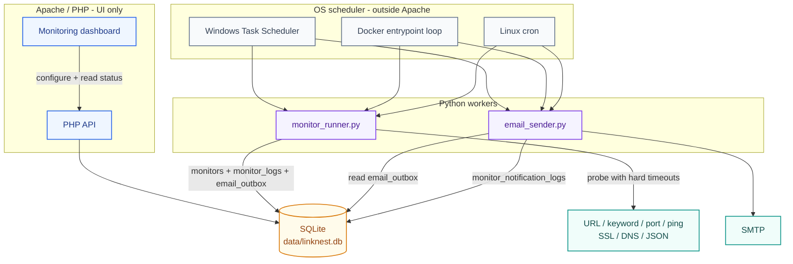
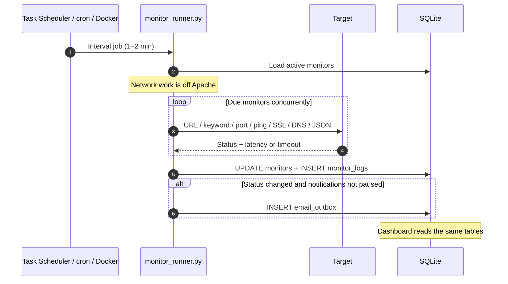
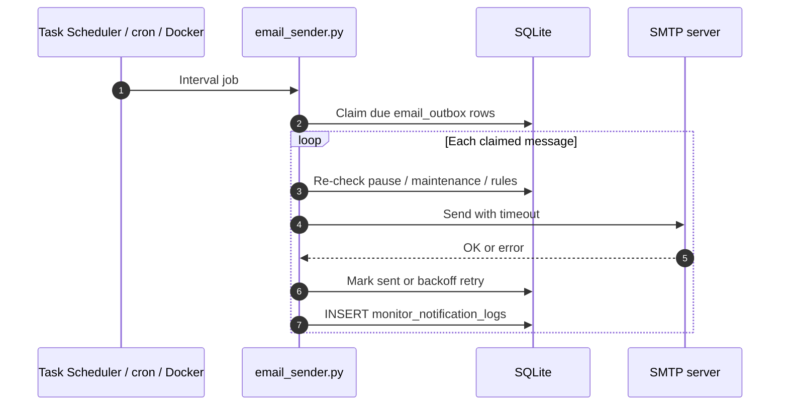

# Python Workers (Monitoring + Email) for LinkNest

These scripts offload scheduled monitoring and SMTP sending from PHP to Python, preventing the **PHP cron job from freezing** when endpoints or SMTP are slow.

Also in-app: **Help & About → Help → System Monitoring Dashboard**, **About**, and **Guides → Python Workers (Monitoring + Email)**.

Workers run as **separate OS processes** (Windows Task Scheduler, Linux cron, or the Docker entrypoint). They are not Apache/PHP request handlers, so a slow URL or stuck SMTP server does not occupy a PHP worker.

## Architecture

Apache/PHP serves the dashboard and stores monitor definitions. Checks and outbound mail run in Python and only share SQLite with PHP.



### Monitor runner

`scripts/monitor_runner.py` loads due monitors, probes them concurrently, then writes results in one SQLite transaction. It **queues** mail; it does not send SMTP.



### Email sender

`scripts/email_sender.py` is a second process so slow SMTP cannot block checks (or Apache).



## Files

- `scripts/monitor_runner.py`
  - Checks due monitors concurrently (hard timeouts).
  - Updates SQLite: `monitors`, `monitor_logs`.
  - Queues notifications into SQLite: `email_outbox`.

- `scripts/email_sender.py`
  - Sends queued emails from `email_outbox` using SMTP settings stored in the LinkNest DB (`settings` table).
  - Writes results into `monitor_notification_logs` (so the UI still shows email history).

## Requirements

- Python **3.9+**
- No external Python packages (stdlib only).

## Database

Default DB path (same as PHP): `data/linknest.db`

The scripts ensure the `email_outbox` table exists automatically (and PHP also creates it in `api/config.php`).

## Run manually (Windows)

From the LinkNest project root:

```powershell
python scripts\monitor_runner.py --verbose
python scripts\email_sender.py --verbose
```

If your DB is in a custom location:

```powershell
python scripts\monitor_runner.py --db C:\path\to\linknest.db --verbose
python scripts\email_sender.py --db C:\path\to\linknest.db --verbose
```

## Windows Task Scheduler (recommended)

### Quick install (recommended)

From the LinkNest project root (as your normal Windows user — **admin not required**):

```bat
scripts\schedule-monitor-workers.bat
```

This runs **preflight → install both tasks → verify (Task Scheduler + schtasks.exe) → smoke test** (one foreground run of monitor + email workers).

```powershell
.\scripts\schedule-monitor-workers.ps1
.\scripts\schedule-monitor-workers.ps1 -IntervalMinutes 2
.\scripts\schedule-monitor-workers.ps1 -Action verify
.\scripts\schedule-monitor-workers.ps1 -Action status
.\scripts\schedule-monitor-workers.ps1 -Action run-once
.\scripts\schedule-monitor-workers.ps1 -Action uninstall
.\scripts\schedule-monitor-workers.ps1 -SkipSmoke   # install without immediate smoke test
```

Or via the `.bat`:

```bat
scripts\schedule-monitor-workers.bat verify
scripts\schedule-monitor-workers.bat status
scripts\schedule-monitor-workers.bat run-once
scripts\schedule-monitor-workers.bat install 2
```

This creates two Task Scheduler jobs:

- **LinkNest - Monitor Runner** — `scripts\monitor_runner.py`
- **LinkNest - Email Sender** — `scripts\email_sender.py`

Default interval is **every 1 minute**. Pass `2` as the second argument to the `.bat` (or `-IntervalMinutes 2`) for every 2 minutes.

### Manual Task Scheduler setup

If you prefer to create tasks by hand:

### Task 1: Monitor Runner

- **Program/script**: `python`
- **Arguments**: `scripts\monitor_runner.py --verbose`
- **Start in**: `C:\xampp\htdocs\linknest`
- **Trigger**: every 1 minute (or 2 minutes)
- **Settings**: If the task is already running → **Do not start a new instance**

### Task 2: Email Sender

- **Program/script**: `python`
- **Arguments**: `scripts\email_sender.py --limit 25 --smtp-timeout 20 --verbose`
- **Start in**: `C:\xampp\htdocs\linknest`
- **Trigger**: every 1 minute
- **Settings**: If the task is already running → **Do not start a new instance**

## Docker (automatic — no Task Scheduler)

Official Docker images start a background loop in `docker/linknest-entrypoint.sh` that runs `monitor_runner.py` then `email_sender.py` on an interval.

| Env var | Default | Meaning |
|---------|---------|---------|
| `LINKNEST_WORKERS_ENABLED` | `1` | Set to `0` to disable workers |
| `LINKNEST_WORKER_INTERVAL_SECONDS` | `60` | Seconds between worker cycles |
| `LINKNEST_WORKER_MAX_WORKERS` | `10` | Concurrent monitor checks |
| `LINKNEST_EMAIL_LIMIT` | `50` | Max emails per email_sender run |
| `LINKNEST_DB_PATH` | `/var/www/html/data/linknest.db` | SQLite path inside the container |

Verify once:

```bash
docker compose -f docker/docker-compose.yml exec -T linknest \
  python3 /var/www/html/scripts/monitor_runner.py --db /var/www/html/data/linknest.db --verbose
```

> On Docker you normally **do not** also install the Windows Task Scheduler scripts on the host (that would double-check the same DB if the DB is bind-mounted).

## Linux cron examples

```bash
* * * * * cd /var/www/linknest && /usr/bin/python3 scripts/monitor_runner.py
* * * * * cd /var/www/linknest && /usr/bin/python3 scripts/email_sender.py --limit 50
```

## Notes / Behavior

- Workers are **independent of Apache/PHP**: they are OS scheduled processes. A hung target cannot occupy a PHP request worker.
- They still share `data/linknest.db` with PHP (WAL + busy timeout). Brief lock waits can occur during writes.
- Monitoring checks are executed concurrently, but DB writes are serialized inside one transaction.
- Emails are queued into `email_outbox` and sent separately, so slow SMTP cannot block monitoring.
- Sent email results are stored in `monitor_notification_logs`, matching how LinkNest UI reads email history today.
- `email_sender.py` also follows the “anti-spam” safeguards:
  - obeys global notification pause windows (does not send while paused)
  - re-checks maintenance windows and enabled/active notification rules before sending
  - exponential backoff on failures (prevents rapid retry spam)
  - short-window duplicate suppression to avoid accidental duplicate sends

