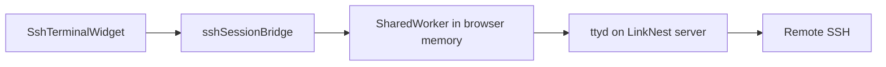

# SSH Session SharedWorker (survive page refresh)

The SSH Terminal can keep **live Easy/Advanced SSH sessions** alive when you refresh the browser page. Sessions are torn down only when you **close the SSH widget** (and confirm if terminals are still open).

Also in-app: **Help & About → Help → SSH sessions across refresh**, and **Guides → SSH Session Shared Worker**.

---

## Short answer

| Question | Answer |
|----------|--------|
| Where does the SharedWorker run? | In **browser memory** (your PC), not on the LinkNest PHP/XAMPP server |
| What survives a page refresh? | Open SSH WebSockets to ttyd (shell stays connected when the worker stays up) |
| What does **not** survive? | Closing **all** LinkNest tabs for that site, quitting the browser, or closing the SSH **widget** |
| RDP tabs? | Restored from saved tab metadata when possible; they are not held by the SharedWorker the same way SSH is |

---

## Why a SharedWorker?

A normal page WebSocket lives only in that page’s JavaScript. A full refresh destroys the page, so the socket (and usually the SSH child behind ttyd) dies.

LinkNest opens SSH I/O through a **SharedWorker** script:

- File served as `ssh-session-shared-worker.js` (from the app `public/` folder / built site root)
- Client bridge: `services/sshSessionBridge.ts`
- Widget wiring: `components/SshTerminalWidget.tsx`

The worker holds the ttyd WebSocket(s). After refresh, the widget **reattaches** to those sessions and replays a short buffer of recent terminal output.

---

## What happens when

| Action | Result |
|--------|--------|
| **Connect** (Easy/Advanced SSH) | Opens a small **SSH session keeper** window and holds the WebSocket in a SharedWorker |
| **Refresh** (F5 / reload) with the SSH widget still enabled | Keeper window keeps the worker alive; UI restores tabs and reattaches — **no new password** when reattach succeeds |
| **Close SSH widget** (X / nav toggle with confirm) | Worker sessions closed; keeper window closed; gateway `stop` called; persisted live-tab list cleared |
| **Close a single tab** `[x]` | That session closed and its gateway stopped |
| **Close every LinkNest tab**, close the keeper, or quit the browser | SharedWorker is gone; SSH must be connected again next time |
| Browser **without** SharedWorker support / worker 404 | Falls back to per-page WebSockets (sessions die on refresh, same as before) |

Open-tab metadata is also stored briefly in **`sessionStorage`** (`linknest.sshTerminal.liveTabs.v1`) so the UI knows which tabs to restore after reload.

### Why a keeper window?

Browsers often **terminate SharedWorkers** when the only page using them reloads (zero clients for a moment). The keeper page stays open so at least one client remains attached and the ttyd WebSocket (and remote shell) stay up. Allow pop-ups for your LinkNest origin if the keeper is blocked.

---

## Requirements

- Modern Chromium, Edge, or Firefox (SharedWorker available)
- Site served over **http(s)** from your LinkNest origin (not a broken `file://` open)
- Same origin after refresh (same host + path base such as `/linknest`)
- Worker script reachable at `ssh-session-shared-worker.js` (Vite builds it into `dist/`; Apache `.htaccess` rewrites the root URL to `dist/ssh-session-shared-worker.js`)
- For Easy mode: ttyd / OpenSSH still running on the server as usual — see [REMOTE_WIDGETS_MANUAL_DEPLOY.md](REMOTE_WIDGETS_MANUAL_DEPLOY.md)

If the worker script cannot be loaded, LinkNest **falls back** to a normal page WebSocket (SSH still connects; sessions will not survive refresh).

---

## User tips

1. Leave the **SSH / RDP widget open** (nav still showing it as on) if you only need to refresh the main app.
2. Allow the **SSH session keeper** pop-up. You can **minimize** it, but leave it open (don’t close it) — required so refresh does not drop the shell.
3. To fully disconnect: close the widget and confirm **Kill all terminals and close?** when prompted.
4. After refresh you may see **Reattached after refresh** — scrollback is partial (recent replay only), but the remote shell is the same one when reattach succeeds.
5. If reattach fails (worker/keeper was killed), LinkNest may **reconnect** using the saved connection / Easy settings (new SSH login → password again).

---

## Admin / developer notes

| Piece | Location |
|-------|----------|
| Worker script | `public/ssh-session-shared-worker.js` |
| Bridge API | `services/sshSessionBridge.ts` |
| Persist key | `sessionStorage` → `linknest.sshTerminal.liveTabs.v1` |
| Widget open flag | `localStorage` → `linknest_show_ssh_terminal_widget` (widget visibility, not the sockets) |

**Security:** The worker runs only in the user’s browser. It does not store SSH passwords. Gateway stop still goes through the authenticated LinkNest API when the widget/tab is closed intentionally.

**Limits:** SharedWorker is shared per origin. Multiple LinkNest tabs can attach to the same worker. ttyd is still typically one client per gateway process; do not expect multi-user sharing of one PTY.

---

## Related guides

- [REMOTE_WIDGETS_SETUP.md](REMOTE_WIDGETS_SETUP.md) — SSH / VNC feature overview  
- [REMOTE_WIDGETS_MANUAL_DEPLOY.md](REMOTE_WIDGETS_MANUAL_DEPLOY.md) — install ttyd, OpenSSH, HTTPS WSS  
- Help & About → **Help → Remote Widgets — SSH / VNC Manual Deployment**
